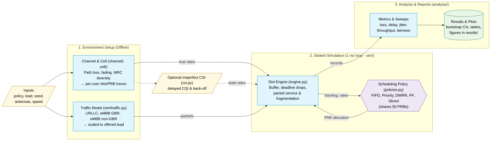
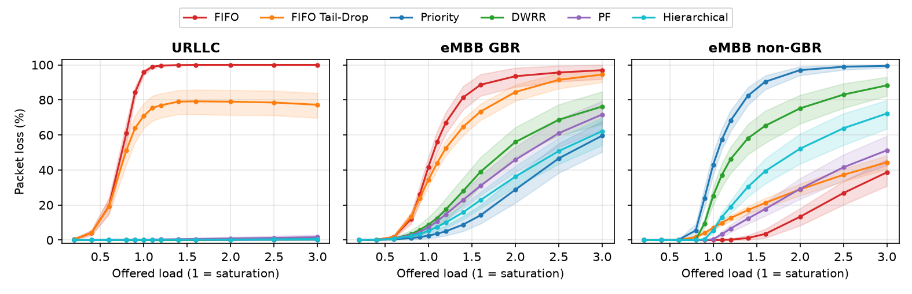
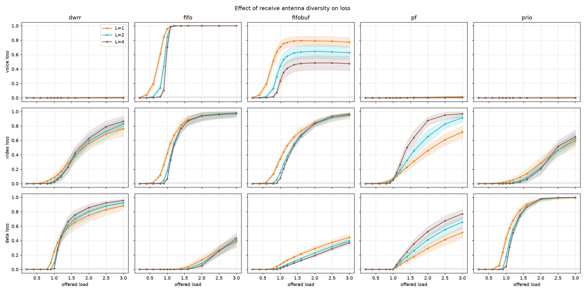

# Multi-User 5G Scheduling over Fading Channels

Simulation of a 5G base station (gNB) downlink serving multiple network slices with heterogeneous 3GPP QoS requirements (URLLC, eMBB GBR, and eMBB non-GBR). Each user's physical rate is modeled through log-distance path loss, static log-normal shadowing, correlated Jakes Rayleigh fading, and optional MRC receive antenna diversity. Under increasing offered load ($\rho \in [0.2, 3.0]$), classical flat scheduling policies (FIFO, strict priority, DWRR, proportional fair) are benchmarked against a **5G Hierarchical Slice Scheduler** (`sliced`). The study evaluates packet loss (PDB deadline violations), tail latency ($D_{p95}$), jitter, goodput, starvation, and Jain's fairness index.

Course project for Wireless Communications (UFSC).

**Status:** Simulator, Monte Carlo experiments (6 policies $\times$ 13 loads $\times$ 3 antenna configs $\times$ 30 seeds = 7,020 runs), sensitivity sweep, imperfect-CSI study, and full test suite (33 passing unit tests) are complete.

## Reused from the Single-User Project

The channel model, its validation, and the statistics helpers come from [Traffic-Scheduling-with-QoS-in-a-Congested-5G-Base-Station](https://github.com/henriquebueno45/Traffic-Scheduling-with-QoS-in-a-Congested-5G-Base-Station) at tag `v1.0`, copied unchanged except for import paths:

| Here | Source (tag `v1.0`) |
|---|---|
| `channel/channel_model.py` | `channel/channel_model.py` |
| `analysis/validate_channel.py` | `analysis/validate_channel.py` |
| `analysis/stats.py` | `boot_ci`, `paired_ci`, `sla_capacity` from `analysis/exp_report.py` |
| `channel/calibration.py` | `equal_mean_distance` from `analysis/experiments.py` |

The channel is validated against theory (outage probability follows Gamma(L, 1) within 0.02 decades for P > 1e-3; level-crossing rate within 2% of Clarke's formula): see `results/outage_validation.png` and `results/channel_validation.png`.

## Architecture



### Reading the diagram:
1. **Offline Environment Setup:** The **channel model** (`channel/`) and **cell** (`cell/`) compute user positions (uniform 20–300 m annulus) and each user's per-slot physical transmission rate (`bits_per_prb`) from log-distance path loss, 6 dB log-normal shadowing, Jakes fading (32 sinusoids, Doppler spread $f_d$), and optional MRC diversity. In parallel, the **traffic model** (`sim/traffic.py`) instantiates arrivals mapped to 3GPP profiles:
   - **URLLC (SST 2, 5QI 82/84):** Periodic 1,600 bits every 20 ms, Packet Delay Budget (PDB) = 20 ms.
   - **eMBB GBR (SST 1, 5QI 2/3):** Periodic 66,000 bits every 33 ms, PDB = 50 ms.
   - **eMBB non-GBR (SST 1, 5QI 8/9):** Poisson 2 Mbit/s (12,000 bit packets), PDB = 500 ms.
2. **1 ms Slotted MAC Simulation:** In every 1 ms slot, the **slot engine** (`sim/engine.py`) enqueues arrivals, drops head-of-line packets that violate their PDB deadline (or tail drops on buffer overflow), and invokes the **scheduling policy** (`sim/policies.py`) to distribute the 50 PRB budget. Under imperfect CSI, transmissions fail (BLER, PRBs wasted, bits stay queued) if the true channel rate is below the delayed CQI estimate.
3. **Analysis & Reports:** After discarding warmup (1,000 slots) and tail (500 slots), multi-run sweeps (`analysis/`) compute metrics with 95% bootstrap confidence intervals and paired comparisons, generating publication-ready figures in `results/`.

---

## Technical Description

The simulator is a slotted (1 ms) discrete-time model of one gNB downlink in 3.5 GHz ($B = 360$ kHz per PRB, $\mu=1$ numerology subframe equivalent):

1. **Channel layer** (`channel/channel_model.py`): Log-distance path loss ($n = 3.5$), static log-normal shadowing ($\sigma = 6$ dB), Jakes sum-of-sinusoids fading (32 paths), and MRC over $L \in \{1, 2, 4\}$ antennas resulting in $\mathrm{Gamma}(L, 1)$ power gain. Truncated Shannon spectral efficiency $\mathrm{SE}_u[t] = \min\{\log_2(1 + \gamma_u[t]), 7.4\}$ bit/s/Hz (256-QAM ceiling).
2. **Cell layer** (`cell/cell.py`): Positions 10 users ($r_u \in [20, 300]$ m) using independent `SeedSequence.spawn` streams for perfect paired evaluation.
3. **Simulation layer** (`sim/`):
   - `traffic.py`: Synthesizes arrivals and computes the cell saturation scale $s$ such that $\rho = 1.0$ matches the aggregate Shannon capacity across the 50 PRBs.
   - `engine.py`: 1 ms discrete-event slot loop with work-conserving PRB allocation, packet fragmentation, and SLA deadline enforcement.
   - `policies.py`: Implements the scheduling policies:
     - `fifo`: First-In First-Out by packet arrival timestamp.
     - `prio`: Strict Priority ($\mathcal{U}_{\mathrm{URLLC}} \succ \mathcal{U}_{\mathrm{video}} \succ \mathcal{U}_{\mathrm{data}}$).
     - `dwrr`: Deficit Weighted Round Robin with class quanta 8:4:2 PRBs and intra-slice FIFO.
     - `pf`: Class-blind Proportional Fair ($\arg\max_u r_u[t] / \bar{R}_u[t]$ with exponential filter $\beta=0.01$).
     - `sliced` (**Hierarchical Slicing**): Two-tier scheduler. **Tier 1 (Inter-slice):** DWRR across slices (weights 8:4:2) ensuring strict SLA isolation, minimum guaranteed quotas, and dynamic work-conserving sharing of unused PRBs. **Tier 2 (Intra-slice):** Urgency-first (oldest deadline) for URLLC; intra-slice Proportional Fair ($\arg\max_{u \in \text{slice}} r_u / \bar{R}_u$) for eMBB GBR and eMBB non-GBR to exploit multiuser diversity.
4. **Experiment layer** (`analysis/`): Multiprocessing sweeps (`experiments.py`, `csi.py`, `sensitivity.py`), statistical bootstrap reporting (`report.py`), and publication figure generation (`article_figs.py`).

---

## Results and Findings

Setup: 50 PRBs, 10 users (4 URLLC, 3 eMBB GBR, 3 eMBB non-GBR), pedestrian speed 1.5 m/s ($f_d = 17.5$ Hz), 30 seeds per load (loads 0.2 to 3.0), 95% bootstrap confidence intervals.

### Who Wins and Who Loses Under Congestion ($\rho = 1.2$, Overload of 20%, $L = 1$)

| Metric / Slice | FIFO | FIFO Tail-Drop | Priority (`prio`) | DWRR (`dwrr`) | PF (`pf`) | Hierarchical (`sliced`) |
|---|:---:|:---:|:---:|:---:|:---:|:---:|
| **URLLC Loss** | 99.6% | 76.9% | 0.1% | 0.1% | 0.4% | **0.1%** |
| **eMBB GBR Loss** | 67.0% | 52.4% | 5.0% | 17.4% | 14.7% | **10.1%** |
| **eMBB non-GBR Loss** | 0.3% | 12.5% | 68.1% | 46.1% | 6.5% | **18.9%** |
| **URLLC Tail Latency ($D_{p95}$)** | 18.7 ms | 20.0 ms | 2.4 ms | 3.6 ms | 2.3 ms | **3.5 ms** |
| **eMBB GBR Tail Latency ($D_{p95}$)** | 49.7 ms | 44.6 ms | 34.2 ms | 42.4 ms | 39.0 ms | **37.0 ms** |
| **non-GBR Starvation (% time)** | 31.2% | 36.8% | **72.9%** | 0.0% | 36.0% | **0.0%** |
| **non-GBR Throughput** | 25.1 Mbps | 21.9 Mbps | 8.4 Mbps | 12.0 Mbps | 23.3 Mbps | **19.6 Mbps** |
| **Jain's Fairness Index ($J$)** | 0.46 | 0.72 | 0.85 | 0.90 | 0.97 | **0.96** |



### Key Insights:
- **Failure of Flat Schedulers:**
  - **FIFO** causes catastrophic failure for URLLC (**99.6% drop rate**) due to *head-of-line blocking* by elastic data packets.
  - **Strict Priority** protects URLLC and video but suffocates the data slice (**72.9% starvation**, 68.1% loss, Jain index drops to 0.85).
  - **DWRR** eliminates starvation (0%) but suffers 46.1% data loss because intra-slice FIFO serves users blindly during deep fades.
  - **Proportional Fair** maximizes aggregated throughput but lacks deterministic latency bounds.
- **Protagonist Role of Hierarchical Slicing (`sliced`):**
  - Combines inter-slice isolation with intra-slice multiuser diversity.
  - Slashes non-GBR data loss from 46.1% (DWRR) down to **18.9%** (a paired reduction of $-27.2$ pp, $p < 0.01$) and boosts throughput by **+64%** (12.0 $\to$ 19.6 Mbps).
  - Lowers video loss from 17.4% to **10.1%** ($-7.4$ pp, $p < 0.01$).
  - Strictly preserves URLLC ($D_{p95} = 3.5\text{ ms} \ll 20\text{ ms}$, loss = 0.1%).
  - Maintains **0.0% starvation** and achieves near-optimal system fairness (**$J = 0.96$**).

---

### SLA Capacity Target ($\ge 99\%$ Delivered within PDB, $L = 1$)

Highest load $\rho$ at which the slice delivers at least 99% of its packets within its PDB:

| Slice / 3GPP Profile | FIFO | FIFO Tail-Drop | Priority | DWRR | PF | Hierarchical (`sliced`) |
|---|:---:|:---:|:---:|:---:|:---:|:---:|
| **URLLC (5QI 82/84)** | 0.30 | 0.30 | $\ge 2.91$ | $\ge 2.82$ | $\ge 2.59$ | $\mathbf{\ge 2.82}$ |
| **eMBB GBR (5QI 2/3)** | 0.57 | 0.54 | 1.21 | 0.92 | 0.82 | **0.92** |
| **eMBB non-GBR (5QI 8/9)** | 1.90 | 0.80 | 0.73 | 0.92 | 1.36 | **1.06** |

The hierarchical scheduler elevates non-GBR SLA capacity from $\rho = 0.92$ to **$\rho = 1.06$** (+15%) without degrading the capacity of priority slices.

---

### Antenna Diversity and Channel Hardening



More receive antennas ($L \in \{1, 2, 4\}$ with MRC) substantially increase URLLC and video capacity across all policies. However, under flat Proportional Fair, higher diversity flattens the Rayleigh fading variance (*channel hardening*), diminishing the opportunistic peaks that PF exploits: video loss under PF at $\rho = 1.2$ rises from 14.7% ($L=1$) to 26.4% ($L=4$). Hierarchical slicing avoids this degradation by guaranteeing minimum PRB shares per slice.

---

### Impact of Stale CSI and Mobility


Evaluating delayed CQI reports ($d \in \{5, 10\}$ ms) and link-adaptation back-off margins ($\beta \in \{0, 3, 6\}$ dB) at pedestrian (1.5 m/s) and vehicular (15 m/s) speeds:
- At 15 m/s ($f_d = 175$ Hz), coherence time falls to $T_c \approx 2.4$ ms, making 5 ms CQI reports completely stale.
- Flat Proportional Fair suffers catastrophic degradation: it schedules users based on outdated fading peaks, driving BLER up to 70% and video loss to 78% (52% with $\beta = 3$ dB back-off).
- In contrast, **Hierarchical Slicing** isolates classes via inter-slice DWRR quotas, preventing stale-CSI retries in one slice from cannibalizing others. At 15 m/s with $\beta = 3$ dB back-off, Hierarchical Slicing restricts video loss to **36.8%** (a 15.2 pp advantage over flat PF) while strictly guaranteeing URLLC loss at **0.2%** (avoiding the near-100% collapse seen in FIFO variants).

---

## Quick Start

```bash
# 1. Environment setup
python3 -m venv .venv && source .venv/bin/activate
pip install -r requirements.txt

# 2. Run test suite (33 unit tests)
PYTHONPATH=. pytest -q tests

# 3. Single-run simulation example
PYTHONPATH=. python -m sim.run --policy sliced --load 1.2 --seed 1

# 4. Regenerate channel theoretical validation plots
PYTHONPATH=. python -m analysis.validate_channel
```

### Reproducing Full Benchmark and Figures

```bash
# Monte Carlo sweep (7,020 runs across 6 policies, 13 loads, 3 antenna configs, 30 seeds)
PYTHONPATH=. python -m analysis.experiments --name main --seeds 30 --workers 6

# Compute bootstrap CIs, paired differences, SLA capacity, and generate results/*.png
PYTHONPATH=. python -m analysis.report --name main

# Generate publication 3-panel figure with clear top legend
PYTHONPATH=. python -m analysis.article_figs

# Imperfect CSI study
PYTHONPATH=. python -m analysis.csi run --seeds 20 --workers 6
PYTHONPATH=. python -m analysis.csi report --load 0.8 --antennas 1
```

## License

MIT, see [LICENSE](LICENSE).
