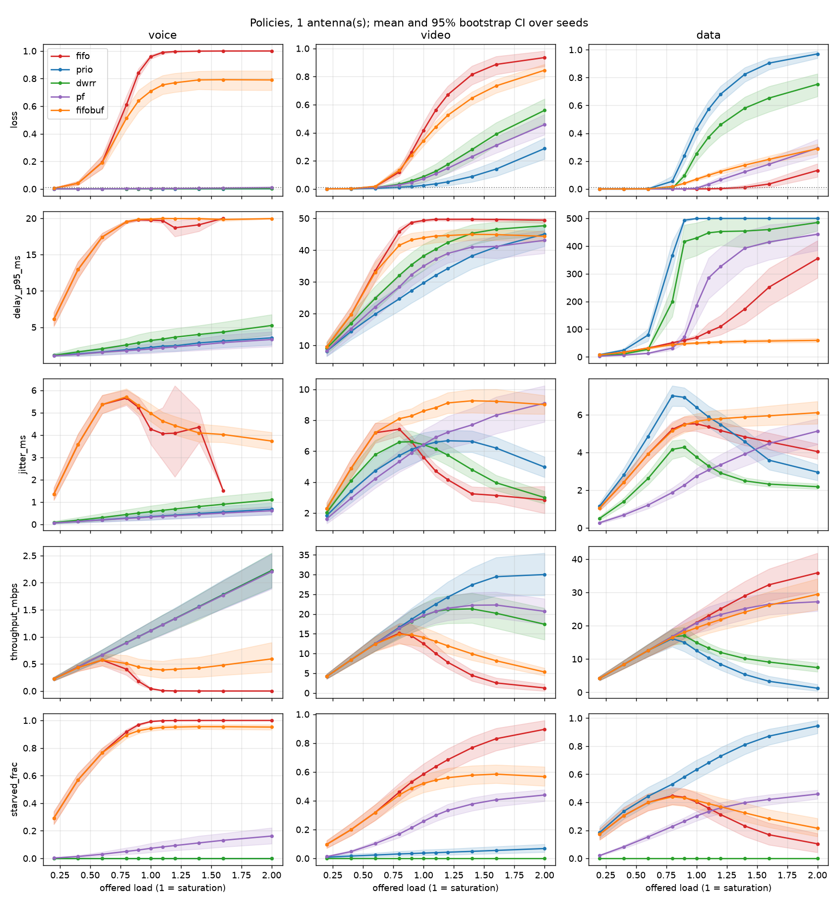
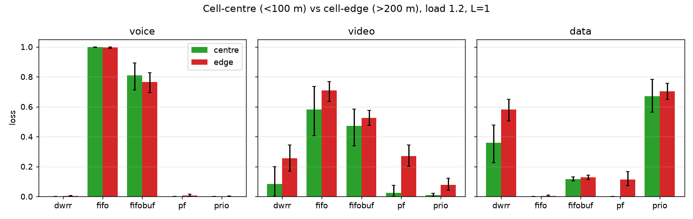
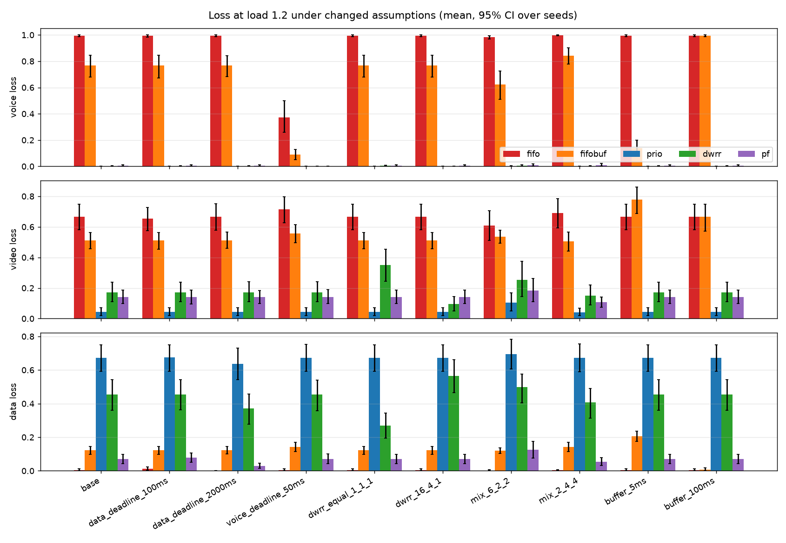

# Multi-User 5G Scheduling over Fading Channels

Simulation of a 5G base station serving several users with different channel qualities. Each user's rate comes from the channel capacity (path loss, shadowing, small-scale fading, optional MRC antenna diversity), and traffic classes (voice, video, data) are served with different scheduling policies under increasing load. The study measures delay, jitter, packet loss, throughput, and starvation per class and per user.

Course project for Wireless Communications (UFSC).

**Status:** simulator, experiments (policy x load x antenna diversity, 30 seeds), sensitivity study and tests are done. Still to do: validation against theory beyond the unit tests, and the written article. Plan and roadmap: [docs/PLAN.md](docs/PLAN.md).

## Reused from the Single-User Project

The channel model, its validation, and the statistics helpers come from [Traffic-Scheduling-with-QoS-in-a-Congested-5G-Base-Station](https://github.com/henriquebueno45/Traffic-Scheduling-with-QoS-in-a-Congested-5G-Base-Station) at tag `v1.0`, copied unchanged except for import paths:

| Here | Source (tag `v1.0`) |
|---|---|
| `channel/channel_model.py` | `channel/channel_model.py` |
| `analysis/validate_channel.py` | `analysis/validate_channel.py` |
| `analysis/stats.py` | `boot_ci`, `paired_ci`, `sla_capacity` from `analysis/exp_report.py` |
| `channel/calibration.py` | `equal_mean_distance` from `analysis/experiments.py` |

The channel is validated against theory (outage probability follows Gamma(L, 1) within 0.02 decades for P > 1e-3; level-crossing rate within 2% of Clarke's formula): see `results/outage_validation.png` and `results/channel_validation.png`. The real-time C/Pthreads core from the original project is deliberately not reused.

## Results

Setup: one cell with 50 PRBs (360 kHz, 1 ms slots), 10 users uniform over 20-300 m (4 voice, 3 video, 3 data), Rayleigh fading with 1.5 m/s mobility, 10 s per run, 30 seeds, 95% bootstrap intervals. **Load 1 is the point where the offered bits would use every PRB** at each user's mean rate. A packet that cannot meet its deadline (voice 20 ms, video 50 ms, data 500 ms) is dropped. Policies: FIFO (oldest packet first, deadline drops only), FIFO with a 20 ms shared tail-drop buffer (`fifobuf`), strict priority (`prio`), DWRR with weights 8/4/2 (`dwrr`), and class-blind proportional fair (`pf`). Single receive antenna unless stated.

### Who wins and who loses under congestion

Packet loss at load 1.2 (the cell is 20% overloaded), one antenna:

| Class | FIFO | FIFO + buffer | Priority | DWRR 8/4/2 | PF |
|---|---|---|---|---|---|
| Voice | 99.6% | 76.9% | 0.1% | 0.1% | 0.4% |
| Video | 67.0% | 52.4% | 5.0% | 17.4% | 14.7% |
| Data | 0.3% | 12.5% | 68.1% | 46.1% | 6.5% |



- **Class-blind FIFO sacrifices the most delay-sensitive traffic.** Older data always sits ahead of new voice packets, and under fading a user in a deep fade needs many PRBs and blocks everyone behind it. Even at load 0.4 FIFO loses voice, which strict priority and DWRR do not.
- **Strict priority** keeps voice and video alive and moves the loss to data, which is starved 73% of the time at load 1.2.
- **DWRR** never starves data (0% starvation), at the price of more video loss than priority. Its behaviour is set by its weights (see sensitivity).
- **PF** has the best overall fairness but no class guarantees; its voice protection comes from favouring good channels, not from class awareness.

Priority over FIFO at load 1.2, paired over seeds: voice -99.6 percentage points [-99.9, -98.9], video -62 [-70, -54], data +68 [+62, +74].

### Load each class can carry (>= 99% delivered)

Highest load at which the class still delivers 99% of its packets, one antenna. Voice values for priority, DWRR and PF are lower bounds (the load grid stops at 2.0).

| Class | FIFO | FIFO + buffer | Priority | DWRR | PF |
|---|---|---|---|---|---|
| Voice | 0.30 | 0.30 | >= 1.97 | >= 1.93 | >= 1.85 |
| Video | 0.57 | 0.54 | 1.17 | 0.89 | 0.79 |
| Data | 1.69 | 0.80 | 0.73 | 0.92 | 1.26 |

### Antenna diversity


More receive antennas (MRC, L = 1, 2, 4) raise the load every class can carry, for every policy. Video capacity under priority goes from 1.17 to 1.70, and under FIFO from 0.57 to 0.93; voice under FIFO from 0.30 to 0.80. Diversity helps most the classes that were being hurt by deep fades. An exception: PF gets *worse* for video and data with more antennas (video loss at load 1.2 goes from 14.7% to 26.4%), because diversity flattens the fading peaks that PF exploits.

### Cell centre versus cell edge



At load 1.2, edge users (> 200 m) lose far more than centre users (< 100 m) under channel-aware policies: PF video loss is 27% at the edge and 2% in the centre, DWRR video 26% against 8%. Priority is the most even (video 8% against 1%, voice below 0.2% everywhere). Per-user fairness (Jain index of delivered fractions) at load 1.2: PF 0.97, DWRR 0.90, priority 0.85, FIFO + buffer 0.72, FIFO 0.46. PF is "fair" because it spreads loss evenly across classes, which is not the same as protecting voice.

### How robust are these conclusions?



One assumption was changed at a time (data deadline 100 ms / 2000 ms, voice deadline 50 ms, user mix 6/2/2 and 2/4/4, DWRR weights, FIFO buffer), 20 seeds, load 1.2.

- **Robust:** the policy ranking never changes. Priority, DWRR and PF keep voice loss at or below 0.6% in every variant; FIFO loses 98% or more of voice in all but the variant that relaxes the voice deadline to 50 ms (37%).
- **FIFO has no good operating point.** Shrinking its buffer to 5 ms protects voice (14% loss) but loses 78% of video and 21% of data; a 100 ms buffer loses 99% of voice. A single FIFO number would be misleading, so both variants are reported.
- **DWRR is a dial, not a single result.** With weights 16/4/1 data loses 57% and video 9.5%; with equal weights video loses 35% and data 27%.

### Limitations

- The traffic mix, deadlines and DWRR weights are modelling choices, not measured values; the sensitivity study shows which results depend on them.
- Load 1 is relative to each seed's realisation, so it varies slightly between seeds.
- Service spent on a packet that then misses its deadline is wasted, so goodput under overload is below the cell capacity.
- Voice capacity of the protected policies is censored at load 2.0.

Raw outputs: `results/main_*.csv` (summary, paired differences, capacity, edge/centre, fairness) and `results/sens_*.csv`.

## Quick Start

```bash
python3 -m venv .venv && source .venv/bin/activate
pip install -r requirements.txt
python -m pytest -q tests
python -m analysis.validate_channel   # regenerates the validation plots
python -m sim.run --policy prio --load 1.3 --seed 1   # one multi-user run: per-class and per-user metrics
```

### Reproducing the results

```bash
python -m analysis.experiments --name main --seeds 30 --workers 6   # about 15 min, resumable
python -m analysis.report --name main                                # tables and plots
python -m analysis.sensitivity run --seeds 20 --workers 6            # about 15 min, resumable
python -m analysis.sensitivity report
```

## License

MIT, see [LICENSE](LICENSE).
