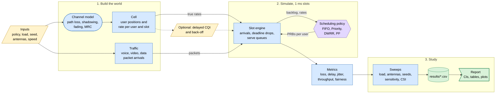

# Multi-User 5G Scheduling over Fading Channels

Simulation of a 5G base station serving several users with different channel qualities. Each user's rate comes from the channel capacity (path loss, shadowing, small-scale fading, optional MRC antenna diversity), and traffic classes (voice, video, data) are served with different scheduling policies under increasing load. The study measures delay, jitter, packet loss, throughput, and starvation per class and per user.

Course project for Wireless Communications (UFSC).

**Status:** simulator, experiments (policy x load x antenna diversity, 30 seeds), sensitivity study, imperfect-CSI study and tests are done. The article (Portuguese, 6 pages) is in `report/`; still to do: theory comparisons (multiuser diversity, M/G/1 priority queue). Plan and roadmap: [docs/PLAN.md](docs/PLAN.md).

## Reused from the Single-User Project

The channel model, its validation, and the statistics helpers come from [Traffic-Scheduling-with-QoS-in-a-Congested-5G-Base-Station](https://github.com/henriquebueno45/Traffic-Scheduling-with-QoS-in-a-Congested-5G-Base-Station) at tag `v1.0`, copied unchanged except for import paths:

| Here | Source (tag `v1.0`) |
|---|---|
| `channel/channel_model.py` | `channel/channel_model.py` |
| `analysis/validate_channel.py` | `analysis/validate_channel.py` |
| `analysis/stats.py` | `boot_ci`, `paired_ci`, `sla_capacity` from `analysis/exp_report.py` |
| `channel/calibration.py` | `equal_mean_distance` from `analysis/experiments.py` |

The channel is validated against theory (outage probability follows Gamma(L, 1) within 0.02 decades for P > 1e-3; level-crossing rate within 2% of Clarke's formula): see `results/outage_validation.png` and `results/channel_validation.png`. The real-time C/Pthreads core from the original project is deliberately not reused.

## Architecture



Reading the diagram: the **channel model** and **cell** produce the rate each user gets in every slot, and the **traffic** block produces the packets. The **slot engine** repeats every millisecond: it asks the **scheduling policy** how to share the 50 PRBs and serves the queues. The dashed path is the optional imperfect-CSI model, which gives the engine a stale rate estimate instead of the true one. The **metrics** of each run feed the **sweeps**, which store everything in CSV files that the **report** turns into confidence intervals, tables and plots.

### Technical description

The simulator is a slotted (1 ms) discrete-time model of one gNB downlink, in four layers that only depend downwards. A run is fully determined by `(policy, load, seed, antennas, ...)`.

1. **Channel layer** (`channel/channel_model.py`, reused from the single-user project). For one user it generates the spectral efficiency per PRB over time: log-distance path loss, static log-normal shadowing, Rayleigh fading from a sum-of-sinusoids Jakes model (32 paths, Doppler from the speed) and MRC over `L` antennas (a Gamma(`L`, 1) gain). The result is `min(log2(1 + SNR), 7.4)`.
2. **Cell layer** (`cell/cell.py`). `generate_cell` draws the user positions (uniform in area over a 20–300 m annulus) and one channel per user, each from its own `SeedSequence.spawn` stream so that a user's channel does not depend on how many other users exist. It returns a `CellRealization` with `bits_per_prb[user, slot]` (SE × 360 kHz × 1 ms), the SE and the distances.
3. **Simulation layer** (`sim/`).
   - `traffic.py` builds per-user packet arrivals (voice and video periodic, data Poisson) and a *saturation scale* so that load 1 fills the 50 PRBs at the realisation's mean rates.
   - `engine.run` is the slot loop. Each slot it (i) enqueues arrivals (tail drop if a shared buffer is set), (ii) drops head-of-line packets past their deadline, (iii) builds a `SlotState` (backlog, head-of-line arrival, bits per PRB, class) and asks the policy for a PRB allocation, (iv) serves each user's queue, fragmenting packets across slots, and (v) records the PRBs per class and the backlog. With `rate_est` set, the policy and the transmitter use the estimated rate and a transmission fails (PRBs wasted, bits stay queued) when the true rate is lower.
   - `policies.py` defines the `Policy` interface (`allocate`, `update`) and its implementations. A new policy only needs to implement `allocate` and be added to the `POLICIES` registry; the engine never looks inside it.
   - `run.simulate` wires it all together, builds `rate_est` from a delayed SE and a back-off, and holds the variant registry (`fifobuf`), the DWRR weights, deadline and buffer overrides and the CLI.
   - `metrics.py` turns the `SimResult` into per-class and per-user tables (the first 1,000 and last 500 slots are excluded).
4. **Experiment layer** (`analysis/`). `experiments.py`, `sensitivity.py` and `csi.py` are resumable sweeps over a `multiprocessing.Pool`: every `(configuration, seed)` job is independent and appends its rows to a CSV, keyed so completed jobs are skipped on restart. `report.py` and `stats.py` read the CSVs and produce bootstrap confidence intervals, paired differences, SLA capacity, edge/centre and fairness tables and the plots in `results/`.

Design choices: all randomness derives from the seed (runs are reproducible and policies are compared on identical channels and traffic, which makes the paired differences valid); the channel and the engine are decoupled by the `bits_per_prb` array, so another channel model can be plugged in without touching the scheduler; and the tests (`tests/`) check each layer separately (channel statistics, link budget, policy invariants, an exact queue recursion, the saturation bound).

## Results

Setup: one cell with 50 PRBs (360 kHz, 1 ms slots), 10 users uniform over 20-300 m (4 voice, 3 video, 3 data), Rayleigh fading with 1.5 m/s mobility, 10 s per run, 30 seeds, 95% bootstrap intervals (loads 0.2 to 3.0). **Load 1 is the point where the offered bits would use every PRB** at each user's mean rate. A packet that cannot meet its deadline (voice 20 ms, video 50 ms, data 500 ms) is dropped. Policies: FIFO (oldest packet first, deadline drops only), FIFO with a 20 ms shared tail-drop buffer (`fifobuf`), strict priority (`prio`), DWRR with weights 8/4/2 (`dwrr`), and class-blind proportional fair (`pf`). Single receive antenna unless stated.

### Who wins and who loses under congestion

Packet loss at load 1.2 (the cell is 20% overloaded), one antenna:

| Class | FIFO | FIFO + buffer | Priority | DWRR 8/4/2 | PF |
|---|---|---|---|---|---|
| Voice | 99.6% | 76.9% | 0.1% | 0.1% | 0.4% |
| Video | 67.0% | 52.4% | 5.0% | 17.4% | 14.7% |
| Data | 0.3% | 12.5% | 68.1% | 46.1% | 6.5% |


- **Class-blind FIFO sacrifices the most delay-sensitive traffic.** Older data always sits ahead of new voice packets, and under fading a user in a deep fade needs many PRBs and blocks everyone behind it. Even at load 0.4 FIFO loses voice, which strict priority and DWRR do not.
- **Strict priority** keeps voice and video alive and moves the loss to data, which is starved 73% of the time at load 1.2.
- **DWRR** never starves data (0% starvation), at the price of more video loss than priority. Its behaviour is set by its weights (see sensitivity).
- **PF** has the best overall fairness but no class guarantees; its voice protection comes from favouring good channels, not from class awareness.

Priority over FIFO at load 1.2, paired over seeds: voice -99.6 percentage points [-99.9, -98.9], video -62 [-70, -54], data +68 [+62, +74].

### Load each class can carry (>= 99% delivered)

Highest load at which the class still delivers 99% of its packets, one antenna. Voice values for priority, DWRR and PF are lower bounds: most seeds never violate the 99% target up to the highest simulated load, 3.0.

| Class | FIFO | FIFO + buffer | Priority | DWRR | PF |
|---|---|---|---|---|---|
| Voice | 0.30 | 0.30 | >= 2.91 | >= 2.82 | >= 2.59 |
| Video | 0.57 | 0.54 | 1.21 | 0.92 | 0.82 |
| Data | 1.90 | 0.80 | 0.73 | 0.92 | 1.36 |

### Antenna diversity


More receive antennas (MRC, L = 1, 2, 4) raise the load that voice and video can carry under every policy. Video capacity under priority goes from 1.21 to 1.75, and under FIFO from 0.57 to 0.93; voice under FIFO from 0.30 to 0.80. Diversity helps most the classes that were being hurt by deep fades. An exception is PF, which gets *worse* for video and data with more antennas (video loss at load 1.2 goes from 14.7% to 26.4%, and its data capacity falls from 1.36 to about 1.1), because diversity flattens the fading peaks that PF exploits.

### Cell centre versus cell edge


At load 1.2, edge users (> 200 m) lose far more than centre users (< 100 m) under channel-aware policies: PF video loss is 27% at the edge and 2% in the centre, DWRR video 26% against 8%. Priority is the most even (video 8% against 1%, voice below 0.2% everywhere). Per-user fairness (Jain index of delivered fractions) at load 1.2: PF 0.97, DWRR 0.90, priority 0.85, FIFO + buffer 0.72, FIFO 0.46. PF is "fair" because it spreads loss evenly across classes, which is not the same as protecting voice.

### How robust are these conclusions?


One assumption was changed at a time (data deadline 100 ms / 2000 ms, voice deadline 50 ms, user mix 6/2/2 and 2/4/4, DWRR weights, FIFO buffer), 20 seeds, load 1.2.

- **Robust:** the policy ranking never changes. Priority, DWRR and PF keep voice loss at or below 0.6% in every variant; FIFO loses 98% or more of voice in all but the variant that relaxes the voice deadline to 50 ms (37%).
- **FIFO has no good operating point.** Shrinking its buffer to 5 ms protects voice (14% loss) but loses 78% of video and 21% of data; a 100 ms buffer loses 99% of voice. A single FIFO number would be misleading, so both variants are reported.
- **DWRR is a dial, not a single result.** With weights 16/4/1 data loses 57% and video 9.5%; with equal weights video loses 35% and data 27%.

### Do the conclusions survive imperfect channel knowledge?


The base station is given a CQI report that is 5 or 10 ms old and transmits at that rate minus a back-off (0, 3 or 6 dB). If the true channel is worse, the transmission fails: the PRBs are wasted and the data is sent again. 20 seeds, speeds 1.5 and 15 m/s, loads 0.8 and 1.2, 1 and 4 antennas (`analysis/csi.py`).

- **Policy ranking survives.** Priority, DWRR and PF still protect voice (below about 11% loss at load 1.2, below 2% with a 3 dB back-off); FIFO and FIFO with a buffer still lose almost all voice. Priority is still the best for video and still starves data (97-99% loss).
- **Everything loses capacity.** At load 0.8 with a 5 ms delay and 3 dB back-off, video loss at 1.5 m/s goes from 3% to 31% (DWRR) and 17% (priority) and data loss from about 0% to 55% (DWRR) and 87% (priority), so load 0.8 is no longer below capacity.
- **PF is the most sensitive to speed.** It picks users at their fading peaks, which a stale report overestimates: its block error rate is 0.32-0.71 at 15 m/s against 0.19 for the others, and its video loss at load 0.8 is 52% (priority: 26%).
- **A moderate back-off is best.** At 1.5 m/s 3 dB beats 6 dB and 0 dB.
- This model is harsher than a real link (no outer-loop adaptation to a 10% error target, no HARQ combining); read it as the direction of the effect, not its size.

### Limitations

- The traffic mix, deadlines and DWRR weights are modelling choices, not measured values; the sensitivity study shows which results depend on them.
- Load 1 is relative to each seed's realisation, so it varies slightly between seeds.
- Service spent on a packet that then misses its deadline is wasted, so goodput under overload is below the cell capacity.
- Voice capacity of the protected policies is censored at load 3.0 (it is a lower bound, because voice is a small share of the total traffic).

Raw outputs: `results/main_*.csv` (summary, paired differences, capacity, edge/centre, fairness) and `results/sens_*.csv`.

## Quick Start

```bash
python3 -m venv .venv && source .venv/bin/activate
pip install -r requirements.txt
python -m pytest -q tests
python -m analysis.validate_channel   # regenerates the validation plots
python -m sim.run --policy prio --load 1.3 --seed 1   # one multi-user run: per-class and per-user metrics
```

### Reproducing the results

```bash
python -m analysis.experiments --name main --seeds 30 --workers 6   # about 15 min, resumable
python -m analysis.report --name main                                # tables and plots
python -m analysis.sensitivity run --seeds 20 --workers 6            # about 15 min, resumable
python -m analysis.sensitivity report
python -m analysis.csi run --seeds 20 --workers 6                    # about 25 min, resumable
python -m analysis.csi report --load 1.2 --antennas 1                # also try --load 0.8
```

## License

MIT, see [LICENSE](LICENSE).
